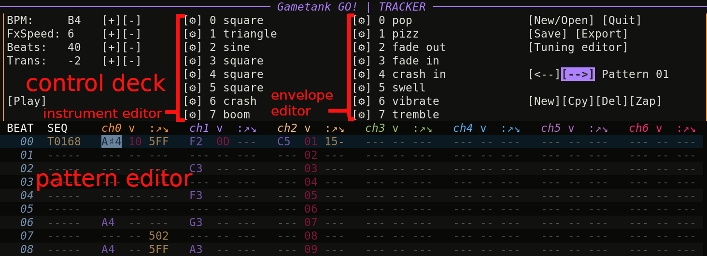
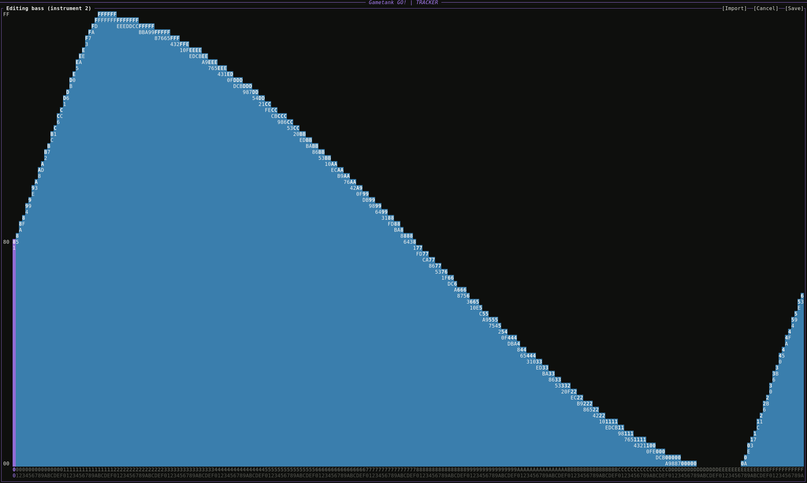
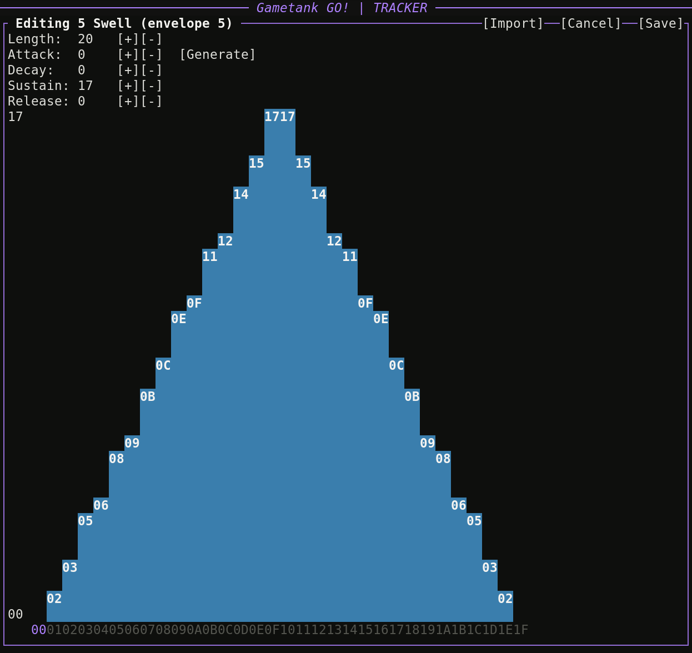

# gt-tracker :: gtt

A music editor/tracker for the [GameTank](https://gametank.zone/).



<!-- Run `npx doctoc README.md to re-generate the TOC` -->
<!-- START doctoc generated TOC please keep comment here to allow auto update -->
<!-- DON'T EDIT THIS SECTION, INSTEAD RE-RUN doctoc TO UPDATE -->

- [Getting started](#getting-started)
- [Anatomy](#anatomy)
- [Pattern editor](#pattern-editor)
- [Control deck](#control-deck)
- [Command palette](#command-palette)
- [Instrument editor](#instrument-editor)
- [Envelope editor](#envelope-editor)
- [Tuning editor](#tuning-editor)
- [Using your tracks](#using-your-tracks)
- [Track descriptor reference](#track-descriptor-reference)
- [Envelope reference](#envelope-reference)

<!-- END doctoc generated TOC please keep comment here to allow auto update -->

## Getting started

Install `gtgo` and `gtt` via Rust: `cargo install gtgo` and `cargo install gtt`

You can then launch `gtgo` from the command line and select the tracker from the menu option.

You can also run the tracker command directly: `gtt [input-file]`

If a file name not specified, you'll be prompted to browse and select a file.


## Anatomy

The screen is organized into a control deck on top and the pattern editor on bottom.
The layout and key bindings are designed to feel familiar to other trackers while also being intuitive to new users.
Use the arrow keys or mouse pointer to jump around the tracker.
Using the tab key toggles focus between the control deck and the pattern editor.


## Pattern editor

Use the arrow keys, page-up/page-down, and the mouse cursor to navigate between rows and columns.
At the top of the pattern editor you'll see:

```
BEAT  SEQ  ch0 v :↗↘   ch1 v :↗↘   ...
```

**BEATS** are represented by the number to the left of each row.
The total set of beats on screen represents a **pattern**.
The number of beats in the pattern can be adjusted on the control deck or via the command palette `:beats [1-255]`.

**SEQ** is the leftmost lane. Sequence Commands are track-wide.
They affect all channels unless a channel explicitly overrides the command.
They are processed at the start of a beat before any voices.
Use Enter/Up/Down/Esc on a SEQ cell to select a sequencer command.

| ID | Label           | Parameters                                     | Description           |
| -- | -----           | ----------                                     | -----------           |
| 0  | (no effect)     |                                                |                       |
| 1  | `[S]top`        | (none)                                         | Ends track playback   |
| 2  | `[T]empo`       | x (0001-0708) = beats per minute               | Updates the track BPM |
| 3  | `F[x]Speed`     | x (00-1F) = number of ticks per beat           | How many ticks per beat channel effects advance. (Higher is faster.) |
| 4  | `[#] FlowCount` | x (00-FF) = value for "count" register         | Replace the value of the count register. Any number greater than 0 will trigger the conditional "CountJump". | 
| 5  | `Count[j]ump`   | x (00-FF) = pattern idx, y (00-FF) = beat idx  | When the count register is greater than 0, jump to the given pattern+beat, then decrement the count register by 1. Essential for looping a section of track a finite number of times. When the register is 0, this command does nothing. |
| 6  | `[J]ump`        | x (00-FF) = pattern idx, y (00-FF) = beat idx  | Unconditionally jump to a given pattern and beat. Useful for jumping to the next pattern or looping a track indefinitely. Note that jumps happen before the target beat is processed. |


**Notes**: select the column with the channel number (ie ch0) and use the top row of letters and numbers for note entry.
The default tuning is mapped similar to a piano roll. This is QWERTY-agnostic, but assuming your keyboard is QWERTY-based, the key binding would work like this:

```
 Note OFF
 ┊     C♯5 D♯5     F♯5 G♯5 A♯5     C♯6 D♯6     F♯6
 ┊   C5┊ D5┊ E5  F5┊ G5┊ A5┊ B5  C6┊ D6┊ E6  F6┊ G6
 ~   │ ┊ │ ┊ │   │ ┊ │ ┊ │ ┊ │   │ ┊ │ ┊ │   │ ┊ │
 ` 1 │ 2 │ 3 │ 4 │ 5 │ 6 │ 7 │ 8 │ 9 │ 0 │ - │ = │
     Q   W   E   R   T   Y   U   I   O   P   [   ]
```

See the [Tuning editor](#tuning-editor) for how to update these mappings.

**Backspace/Delete** key removes the note/command the cursor has selected.

**`/~** sets Note OFF. While an empty beat carries a note, an explicit Note OFF effectively ends the note by temporarily muting the channel.

**v** represents volume. Entered as a two-digit hexadecimal value from `00` to `17`, where `00` is silence and `17` is full volume. The levels are spaced 1.3dB apart at the loud end, widening to 3.5dB at the quiet end so that level `01` is about -42dB and fades end smoothly, so each step is a roughly equal change by ear. Type 0-9/A-F to set the level or `-`/`=` to decrement/increment. The last set volume carries to the next note, even if a note OFF is set along the way.

**Fx** lets you apply effects per channel. Effects apply at the start of the beat before the note is processed.

| ID | Label       | Parameters                                               | Description                                    |
| -- | -----       | ----------                                               | -----------                                    |
| 0  | (no effect) |                                                          |                                                |
| 1  | Instrument  | x (0-7) = instrument index                               | Switch which instrument this channel is using. |
| 2  | Arpeggio    | x (0-F) = how many steps up to the second note,<br>y (0-F) = optional, steps up for a third note. | The arpeggiation steps to its next note once per tick, and FxSpeed sets how many ticks occur per beat. So an FxSpeed of `05` yields 3 ticks/notes a beat. |
| 3  | PitchUp     | x (00-FF) = how many steps up to slide to                | Portamento that increments at a rate of FxSpeed. |
| 4  | PitchDown   | x (00-FF) = how many steps down to slide to              | Portamento that decrements at a rate of FxSpeed. |
| 5  | Envelope    | x (00-07) = envelope slot, any higher value = off        | Assign a volume envelope to the channel. Like the instrument, the assignment persists across beats until changed. Assign a value of `08` or higher (`FF` by convention) to remove any envelope on a channel. |

## Control deck

The control deck allows you to edit global track parameters, pattern-level parameters, as well as convenient buttons for common Command palette (`:command`) actions.

**BPM** is the global BPM, entered in hex from 0001 to 0708 (1-1800).

**Beats** changes the length of the current pattern.

**Trans** transposes the key bindings up/down one unison. With the default tuning, this means incrementing up one octave from c5-g6 to c6-g7. SHIFT key will also shift the range up temporarily.

**FxSpeed** is the starting effects speed for the track (see **SEQ** commands for more details).

**Instruments** - there are 8 total instruments, which can be swapped out on any beat on any channel to provide a lot of versatility. Instruments can be renamed from here, and their waveforms opened in the instrument editor from the `[⚙]` buttons. A new track starts with a spread of basic waveforms and two noise instruments.

**Envelopes** - there are 8 total volume envelopes, assigned to a channel with the Envelope effect the same way an instrument is. They can be renamed from here, and their shapes opened in the [envelope editor](#envelope-editor) from the `[⚙]` buttons.

**Tuning editor** opens the [tuning editor](#tuning-editor) for key assignment.

**New/Open** will allow you to open an existing file or create a new file (press `n`). Default name is `track.gtt` or `track{n}.gtt` to avoid overwriting. Be sure to save before opening another file.

**Save** writes the changes in memory to file.

**Quit** will prompt to save changes before exiting so that you don't accidentally close the program with unsaved changes.

**Export** saves the track, instruments, and tuning into a format consumable by the project. See [Using your tracks](#using-your-tracks) below.


## Command palette

This provides quick keyboard-driven actions. All the commands available on the control deck are available on the command palette, plus more.
When you start typing `:` your command input will start appearing at the very bottom of the screen.
Press Enter to execute or Esc to cancel the command input.

| command          | description                             |
| -------          | -----------                             |
| `:exp`/`:export` | export track                            |
| `:instrument`    | open instrument editor                  |
| `:envelope`      | open envelope editor                    |
| `:m`             | toggle mute on the active voice channel |
| `:mute`/`:unmute`| mute/unmute the active voice channel    |
| `:q`/`:quit`     | quit the application                    |
| `:s`/`:solo`     | solo the active voice channel (mutes all other channels, or unmutes all if already soloed) |
| `:w`/`:write`    | save changes to file                    |

TODO: lots more commands


## Instrument editor



An instrument is a 256-sample waveform, 256 single-byte data points.
This is represented by 256 bars (00-FF) with adjustable height.
You can adjust the data points by dragging the mouse cursor like a brush stroke.
For fine tuning the values, you also have the arrow keys.
Each byte is an unsigned 8-bit PCM sample:

| value         | description                  |
| ------------- | ---------------------------- |
| `0x80`        | Zero / silence (DC midpoint) |
| `0x81`-`0xFF` | Positive half-cycle          |
| `0x00`-`0x7F` | Negative half-cycle          |

For exporting and importing, you can use the `[Export]` button on the Control Deck to export out the raw waveform from a given track, then within the instrument editor use the `[Import]` button to slot in an instrument waveform you already made.

Simply click `[Cancel]` or `[Save]` when done.

## Envelope editor



This gives you control to turn the wave samples into things that mimmick instruments and sounds in the real word.
A noise channel with a sharp attack or sharp decay could become a percussion.
A release allows a single note across beats to be broken up into distinct key presses.

An envelope describes the volume of a voice over the span of a beat.
Any of the envelopes can be assigned to any of the channels.
The header fields set Length plus the Attack, Decay, Sustain and Release parameters.
Each step is a value between `00`-`17` just like channel value.
In other words, this is the level this would play at if the channel volume were `17`. The shape is therefore proportional at different set volumes.

Length is the number of steps, 1 to 32, and is purely a resolution choice.
Because an envelope always fills one beat, a 4-step envelope is four coarse levels and a 32-step envelope is a smooth glide, and both behave the same at any tempo.
Bars can be adjusted like in the instrument editor.
`[Generate]` fills the grid from them, growing Length if the attack, decay and release need more steps than the current length, and holding the sustain level across whatever steps remain.
`[Import]` loads an exported `envelope_<n>.bin`.
Click `[Cancel]` or `[Save]` when done.

## Tuning editor

This window serves two purposes.
One, it defines the music notation mapping used for pattern editing, in other words the tuning system used as the basis for your music.
Two, it allows you to create key bindings to those notes to create a mapping ergonomic for your setup.
The default tuning and key bindings outlined above will be familiar to users of DefleMask and MilkyTracker.

You can import [Scala scale files (.scl)](https://www.huygens-fokker.org/scala/scl_format.html) if you want to get crazy and make some [microtonal tracks](https://youtu.be/QBC8Bjxu5y8).
Imported scales are populated to my best guess of the usable frequency range of the APU firmware, 7Hz-4200Hz.

The tuning lives inside the track file and exports with it.

To adjust the key bindings, click on the row and press a key to see it appear under the "Key assign" column.
The key bindings lives in your application config:

| Linux | macOS | Windows |
| ----- | ----- | ------- |
| `$XDG_CONFIG_HOME/gtt/default-config.toml` or `$HOME/.config/gtt/default-config.toml` | `$HOME/Library/Application Support/gtt/default-config.toml` | `{FOLDERID_RoamingAppData}/gtt/config/default-config.toml` |

Just click `[Cancel]` or `[Save]` when done.


## Using your tracks

Clicking **Export** creates a `<name>-export/` folder next to your gt-tracker file:

```
mycooltrack-export/
  instruments/         instrument raw waveform files
  envelopes/           envelope shapes and the volume scale table
  mycooltrack.bin      pattern data, ready to embed
```

Follow the instructions for your SDK on how to incorporate the track data into your project.

- [C SDK](https://github.com/clydeshaffer/gametank_sdk) - use the external [gttAudio module](https://codeberg.org/jaythomas/gttAudio)
- [Rust SDK](https://github.com/dwbrite/gametank-sdk) - already integrated (see README)


## Track descriptor reference

The exported `<name>-export/<name>.bin` is made of four parts. Every pattern keeps
its arrays dense so the sequencer can index straight to a beat without scanning,
but arrays a pattern never uses are omitted entirely.

**1. Header** fixed at 6 bytes, starting at offset 0.

| offset | type  | field           | description                                        |
| ------ | ----  | -----           | -----------                                        |
| 0      | `u16` | `bpm`           | Base tempo, beats per minute                       |
| 2      | `u16` | `speed`         | FxSpeed. Track-wide number of ticks per effect     |
| 4      | `u8`  | `pattern_count` | Number of unique patterns                          |
| 5      | `u8`  | `freq_count`    | Number of frequency table entries, slot 0 included |

**2. Patterns table** immediately follows the header at byte offset 6. It is a variable-sized array where each entry tells the location of the pattern data block for the given pattern index.

| index                | type  | value                                                              |
| -------------------- | ----  | -----                                                              |
| 0                    | `u16` | Offset from the start of the file to pattern 0's data block        |
| 1                    | `u16` | Offset from the start of the file to pattern 1's data block        |
| ...                  | ...   | ...                                                                |
| `pattern_count - 1`  | `u16` | Offset from the start of the file to the last pattern's data block |

**3. Frequency table** follows the patterns table at byte offset `6 + pattern_count * 2`. A track rarely uses more than a few dozen distinct pitches, so each one is stored once here and referenced by a one-byte index everywhere else.

| index              | type  | value                                                    |
| ------------------ | ----  | -----                                                    |
| 0                  | `u16` | Reserved, always `0x0000`. An index of 0 means "no note" |
| 1 ...              | `u16` | 16-bit phase increment for one distinct pitch            |

Exporting fails if a track needs more than 255 distinct frequencies.

**4. Pattern data blocks**, one per patterns table entry. Located at the offset given by that entry. Each block starts with a 3-byte header:

| offset | type | field          | description                                                                            |
| ------ | ---- | -----          | -----------                                                                            |
| 0      | `u8` | `beats`        | Row count for this pattern                                                             |
| 1      | `u8` | `channel_mask` | Bits 0-6 mark channels that have arrays in this block. Bit 7 (`0x80`) marks a seq list |
| 2      | `u8` | `fx_mask`      | Bits 0-6 mark channels that also carry the three effect arrays                         |

A channel whose `channel_mask` bit is clear reads as silent for the whole pattern,
which still ends any effect a previous pattern left running.

If `channel_mask` bit 7 is set, a sequence command list follows the header. Commands
are sparse, so only beats that carry one are stored, in ascending beat order:

```
seq_count: u8
seq_count entries of 4 bytes each:
  beat    sequence command's beat index within the pattern
  cmd     sequence command ID (see SEQ definitions above)
  value   raw command value (unused for Stop; pattern index for Jump/CountJump)
  value2  second raw command value (target beat for Jump/CountJump, high byte for Tempo)
```

The channel arrays come last, one group per channel flagged in `channel_mask`, in
ascending channel order. Each array is `beats` bytes long:

```
note_idx[beats]       frequency table index for the beat's note; 0 = no note
vol_fx[beats]         packed volume and effect ID, see below
only when the channel's fx_mask bit is set:
  fx_x[beats]           raw effect parameter (instrument slot, or envelope slot where anything past 07 means off)
  fx_arg_x_idx[beats]  frequency table index for the baked fx_x target (Arpeggio's +x note, or PitchUp/PitchDown's slide target)
  fx_arg_y_idx[beats]  frequency table index for Arpeggio's +y note; 0 = two-note arpeggio
```

`vol_fx` packs both per-beat values a channel almost always needs into one byte:

| bits  | field       | description                                                             |
| ----- | -----       | -----------                                                             |
| 0-4   | `volume`    | Volume 0-23; 24 is a note OFF, which silences the channel and suspends its envelope; 31 means hold the channel's previous volume |
| 5-7   | `fx_id`     | Channel effect ID 1-7 (see channel FX definitions above); 0 = no effect |

## Envelope reference

The `envelopes/` folder holds one `envelope_<n>.bin` per slot, each 35 bytes:

```
step_count    number of steps used, 1-32
threshold_lo  low byte of the per-step accumulator threshold
threshold_hi  high byte of the per-step accumulator threshold
steps[32]     one level per step on the 0-23 volume ladder
```

Envelopes span an entire beat, so the threshold is the beat threshold divided by `step_count`, computed at export.
Steps past `step_count` repeat the last used step so the array is a fixed stride, letting a player index a slot's row with a shift.

`volume_scale.bin` is a 768-byte table that resolves an envelope step against the channel's set volume.
Rows are the set volume and columns the envelope step, with a row stride of 32 so the row offset is also a shift.
Both axes are the same logarithmic ladder, so combining two gains is a sum of attenuations, again, folded into this table at export rather than multiplied at runtime.
Columns 24-31 pad each row with the set volume.
